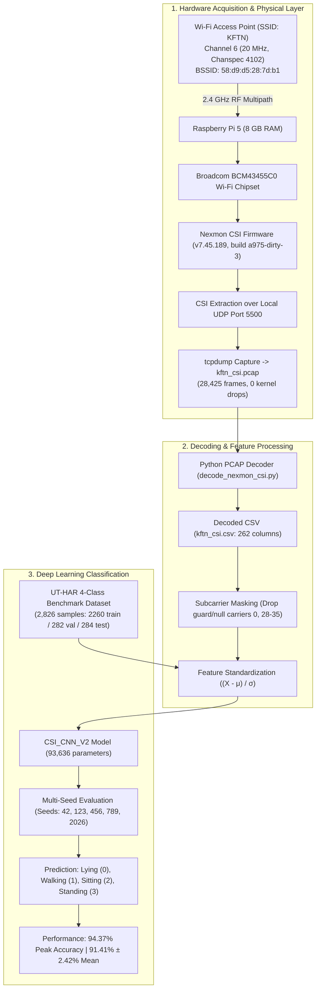

# Wi-Fi CSI Human Activity Recognition (CSI-HAR)

[](https://opensource.org/licenses/MIT)
[](https://www.python.org/downloads/)
[](https://pytorch.org/)
[](https://www.raspberrypi.com/)
[](https://github.com/seemoo-lab/nexmon_csi)

An end-to-end research project and reproducible implementation of **device-free Wi-Fi Channel State Information (CSI) sensing** for Human Activity Recognition (HAR), running on a **Raspberry Pi 5** with **Broadcom BCM43455C0** and deep convolutional neural networks.

---

## Table of Contents
- [1. What is Wi-Fi CSI?](#1-what-is-wi-fi-csi)
- [2. Problem Statement](#2-problem-statement)
- [3. Why Wi-Fi Senses Human Movement](#3-why-wi-fi-senses-human-movement)
- [4. End-to-End System Architecture](#4-end-to-end-system-architecture)
- [5. Hardware Specifications](#5-hardware-specifications)
- [6. Software Environment](#6-software-environment)
- [7. Raspberry Pi & Nexmon CSI Pipeline](#7-raspberry-pi--nexmon-csi-pipeline)
- [8. Physical CSI Acquisition & Packet Structure](#8-physical-csi-acquisition--packet-structure)
- [9. CSI Decoding](#9-csi-decoding)
- [10. Public Benchmark Dataset (UT-HAR 4-Class)](#10-public-benchmark-dataset-ut-har-4-class)
- [11. Preprocessing & Normalization](#11-preprocessing--normalization)
- [12. Deep Learning Model Architecture](#12-deep-learning-model-architecture)
- [13. Training Configuration](#13-training-configuration)
- [14. Empirical Results & Multi-Seed Validation](#14-empirical-results--multi-seed-validation)
- [15. Confusion Matrix & Activity Analysis](#15-confusion-matrix--activity-analysis)
- [16. Known Limitations](#16-known-limitations)
- [17. Reproducibility & Installation](#17-reproducibility--installation)
- [18. Repository Structure](#18-repository-structure)
- [19. References & Acknowledgments](#19-references--acknowledgments)

---

## 1. What is Wi-Fi CSI?

In standard Wi-Fi communication (IEEE 802.11a/g/n/ac/ax), transmission across radio channels is split across multiple orthogonal subcarrier frequencies using **Orthogonal Frequency Division Multiplexing (OFDM)**. 

While everyday devices only expose **Received Signal Strength Indicator (RSSI)**—a coarse, single-scalar metric of total received power—Wi-Fi physical layers internally compute the **Channel State Information (CSI)**. CSI describes how a signal propagates from the transmitter to the receiver along multiple reflection paths, reporting the complex channel frequency response (CFR) for each subcarrier:

$$H(f, t) = |H(f, t)| e^{j \angle H(f, t)}$$

Where:
* $|H(f, t)|$ represents **subcarrier amplitude attenuation**.
* $\angle H(f, t)$ represents **subcarrier phase shift**.

Unlike RSSI, CSI captures frequency-selective fading, multipath interference, and Doppler frequency shifts, making it a high-resolution spatial sensor.

---

## 2. Problem Statement

Existing Human Activity Recognition (HAR) solutions suffer from fundamental real-world tradeoffs:
* **Wearable sensors** (smartwatches, accelerometers): Require constant battery charging, physical compliance, and discomfort for elderly or hospital patients.
* **Optical cameras**: Cause severe **privacy violations** in private spaces (bedrooms, bathrooms), require direct line-of-sight (LoS), and degrade completely in darkness or smoke.

**Goal**: Build a privacy-preserving, device-free, non-line-of-sight sensing system using ubiquitous ambient Wi-Fi signals captured on a low-cost, commercial single-board computer (Raspberry Pi 5) paired with a deep neural network to accurately recognize human activities.

---

## 3. Why Wi-Fi Senses Human Movement

In an indoor space, Wi-Fi radio waves bounce off walls, ceilings, floors, and the human body. The human body is composed of approximately 60–70% saltwater, making it a strong reflector and scatterer of 2.4 GHz and 5 GHz radio frequencies.

```
       [ Wi-Fi Router (AP) ]
             /       \
            /         \  Dynamic Reflection Off Human Limbs
     Direct LoS Path   \        [ Walking / Sitting ]
          /              \          /
         v                v        v
         =======> [ Raspberry Pi 5 ] <======= Multipath Superposition
```

When a person moves:
1. Dynamic reflection paths change in length at the speed of the moving torso and limbs.
2. Changes in path length introduce **Doppler frequency shifts** ($f_d = \frac{v}{\lambda} \cos \theta$).
3. The waves recombine at the receiver antenna, producing time-varying constructive and destructive interference patterns across individual subcarrier frequencies.
4. Each distinct activity (walking, sitting, standing, lying) generates unique, identifiable spatio-temporal signatures in the CSI amplitude and phase matrices.

---

## 4. End-to-End System Architecture



---

## 5. Hardware Specifications

| Component | Technical Details | Role |
| :--- | :--- | :--- |
| **SBC** | Raspberry Pi 5 Model B (8 GB LPDDR4X) | Hardware capture receiver & decoder |
| **Wi-Fi Chipset** | Broadcom / Cypress BCM43455C0 (Revision 6) | 1×1 SISO 802.11ac physical-layer transceiver |
| **Wi-Fi AP** | Commercial 802.11n Access Point | Transmitter emitting ambient frames |
| **Camera (Auxiliary)** | Sony IMX219 (8 MP) | Visual ground-truth verification (part of broader FYDP) |

---

## 6. Software Environment

* **Operating System**: Debian GNU/Linux 13 (Trixie) ARM64 / aarch64
* **Kernel**: `6.18.39+rpt-rpi-v8` (4 KB memory page architecture)
* **Programming Environment**: Python 3.10+ with PyTorch 2.0+, NumPy, Pandas, Scikit-learn, Matplotlib, SciPy.

---

## 7. Raspberry Pi & Nexmon CSI Pipeline

Standard Linux drivers discard raw channel responses after packet decoding. **Nexmon CSI** patches the Broadcom firmware to extract channel estimates from the D11 core:
* **Firmware Version**: `7.45.189`
* **Nexmon Build**: `a975-dirty-3`
* **Chip Code**: `101` (`0x65`)
* **Chanspec Code**: `4102` (Channel 6, 20 MHz width, 2.437 GHz)
* **Local Delivery**: The patched firmware writes synthetic UDP datagrams containing the CSI matrix to port `5500`.

---

## 8. Physical CSI Acquisition & Packet Structure

During physical acquisition, `tcpdump` captured a continuous 29.33-minute stream:
* **Capture File**: `kftn_csi.pcap` (9,440,788 bytes ≈ 9.44 MB)
* **Total Frames**: 28,425 CSI frames (0 packets dropped by kernel)
* **Capture Duration**: 1,759.72 seconds

### UDP Payload Breakdown (274 Bytes per Packet)
1. **Nexmon Header (18 Bytes)**:
   * Magic word: `0x1111`
   * Transmitter MAC: `58:D9:D5:28:7D:B1`
   * Sequence ID, Radio Core (`0`), Chanspec (`4102`), Chip ID (`101`)
2. **CSI Matrix Data (256 Bytes)**:
   * 64 subcarriers $\times$ 4 bytes = 256 bytes.
   * Each complex sample contains a signed 16-bit real component (`int16`) and signed 16-bit imaginary component (`int16`).

### Empirical Inter-Frame Arrival Analysis
The capture stream is **not an idealized uniform 16.0 FPS clock**:
* **Mean Frame Rate**: 16.153 frames/sec (mean gap: 0.06191 s)
* **Median Interval**: 0.00250 s (reflecting burst packet delivery from router traffic)
* **Gaps > 0.1 s**: 2,494 intervals (8.77%)
* **Gaps > 1.0 s**: 442 intervals (1.55%)
* **Implication**: Any real-time inference loop must implement a temporal buffer or spline resampling to project incoming packets onto uniform time grids.

---

## 9. CSI Decoding

The decoder (`raspberry_pi/decoder/decode_nexmon_csi.py`) extracts complex subcarrier values and computes physical metrics:

$$\text{Amplitude}_i = \sqrt{\text{Real}_i^2 + \text{Imag}_i^2}, \quad \text{Phase}_i = \operatorname{atan2}(\text{Imag}_i, \text{Real}_i)$$

The resulting CSV (`kftn_csi.csv`) contains 28,425 rows and 262 columns:
* Columns 1–6: Metadata (`timestamp`, `src_mac`, `sequence`, `core`, `chanspec`, `chip`)
* Columns 7–70: Real components (`sc_0_real` to `sc_63_real`)
* Columns 71–134: Imaginary components (`sc_0_imag` to `sc_63_imag`)
* Columns 135–198: Amplitudes (`sc_0_amplitude` to `sc_63_amplitude`)
* Columns 199–262: Phases (`sc_0_phase` to `sc_63_phase`)

### Guard & Null Carrier Filtering
Subcarrier statistical analysis identified that carriers `[0, 28, 29, 30, 31, 32, 33, 34, 35]` correspond to DC nulls and central pilot bands with extreme static amplitudes (e.g. Subcarrier 29 mean amplitude $\approx 34,916$, Std = 164.79). These are masked out during sensing visualization and modeling.

---

## 10. Public Benchmark Dataset (UT-HAR 4-Class)

To train and validate the deep learning classifier, the project leverages the **UT-HAR** dataset (Yousefi et al., 2017) via the **SenseFi** benchmark (Yang et al., Patterns, Cell Press, 2023).

### Target Activities & Class Distribution
Four foundational activities were extracted and remapped:

| Class ID | Activity | Train Samples | Validation Samples | Test Samples | Total Samples |
| :---: | :--- | :---: | :---: | :---: | :---: |
| **0** | **Lying** | 525 | 66 | 66 | 657 |
| **1** | **Walking** | 1,172 | 146 | 147 | 1,465 |
| **2** | **Sitting** | 320 | 40 | 40 | 400 |
| **3** | **Standing** | 243 | 30 | 31 | 304 |
| **Total** | | **2,260** (80.0%) | **282** (10.0%) | **284** (10.0%) | **2,826** |

* **Input Tensor Dimensions**: `(Batch_Size, 1, 250, 90)`
  * `1` input channel
  * `250` temporal samples
  * `90` subcarrier features (3 receiver antennas $\times$ 30 subcarriers)

---

## 11. Preprocessing & Normalization

1. **Z-Score Standardization**: Unlike the unnormalized baseline (v1), the optimized pipeline (v2) applies global standardization derived strictly from the training split to avoid data leakage:
   $$\mu = 0.082776, \quad \sigma = 0.054368 \implies X_{\text{norm}} = \frac{X - \mu}{\sigma}$$
2. **Inverse-Frequency Loss Weighting**: Corrects for class imbalance (Walking = 51.8%, Standing = 10.7%):
   $$w = [1.0762, 0.4821, 1.7656, 2.3251]$$

---

## 12. Deep Learning Model Architecture

The `CSI_CNN_V2` model is a lightweight 2D Convolutional Neural Network optimized for localized spatio-temporal CSI spectrogram features:

```
Input: (B, 1, 250, 90)
  │
  ├── Block 1: Conv2d(1->32, k=3, p=1) -> BatchNorm2d -> ReLU -> MaxPool2d(2)  => (B, 32, 125, 45)
  ├── Block 2: Conv2d(32->64, k=3, p=1) -> BatchNorm2d -> ReLU -> MaxPool2d(2) => (B, 64, 62, 22)
  ├── Block 3: Conv2d(64->128, k=3, p=1) -> BatchNorm2d -> ReLU -> MaxPool2d(2) => (B, 128, 31, 11)
  │
  ├── AdaptiveAvgPool2d((1, 1))                                                 => (B, 128, 1, 1)
  ├── Flatten()                                                                 => (B, 128)
  ├── Dropout(p=0.30)
  └── Linear(128 -> 4)                                                          => (B, 4)
```

* **Total Parameters**: 93,636 (100% trainable, 384 KB file size).

---

## 13. Training Configuration

| Parameter | Baseline (v1: `train_cnn.py`) | Optimized (v2: `train_cnn_v2.py`) |
| :--- | :--- | :--- |
| **Optimizer** | Adam | Adam |
| **Learning Rate** | `0.001` (constant) | `0.001` (with `ReduceLROnPlateau`, factor 0.5, patience 3) |
| **Weight Decay** | `1e-4` | `1e-4` |
| **Batch Size** | 32 | 32 |
| **Max Epochs** | 30 | 50 |
| **Early Stopping** | None | `patience = 8` (monitors validation Macro-F1) |
| **Normalization** | None | Train-set Z-Score Standardization |
| **Model Selection** | Validation Accuracy | Validation Macro-F1 |

---

## 14. Empirical Results & Multi-Seed Validation

### Single-Run Peak Performance (v2, Seed 42)
* **Test Accuracy**: **94.37%** (268 correct out of 284)
* **Test Macro Precision**: **90.14%**
* **Test Macro Recall**: **91.70%**
* **Test Macro F1**: **90.66%**

### Multi-Seed Statistical Validation (5 Seeds)
To guarantee that findings are statistically robust and not an artifact of random weight initialization, the complete training cycle was executed across 5 distinct random seeds (`42, 123, 456, 789, 2026`):

| Random Seed | Best Epoch | Best Val F1 | Test Accuracy | Test Precision | Test Recall | Test F1 |
| :---: | :---: | :---: | :---: | :---: | :---: | :---: |
| **42** | 46 | 0.980499 | **0.943662 (94.37%)** | 0.901354 | 0.916988 | 0.906599 |
| **123** | 19 | 0.953690 | 0.908451 (90.85%) | 0.845452 | 0.858765 | 0.846954 |
| **456** | 34 | 0.962790 | 0.933099 (93.31%) | 0.897080 | 0.890980 | 0.886900 |
| **789** | 27 | 0.961380 | 0.901408 (90.14%) | 0.845133 | 0.828639 | 0.834281 |
| **2026** | 12 | 0.920155 | 0.883803 (88.38%) | 0.817843 | 0.845352 | 0.818131 |
| **Mean** | — | — | **91.41%** | **86.14%** | **86.81%** | **85.86%** |
| **Std (ddof=1)**| — | — | **± 2.42%** | **± 3.64%** | **± 3.56%** | **± 3.70%** |

---

## 15. Confusion Matrix & Activity Analysis

```
Test Set Confusion Matrix (CNN v2, Seed 42, N = 284):

               Predicted Lying   Predicted Walking   Predicted Sitting   Predicted Standing
Actual Lying         58                  0                   5                   3
Actual Walking        0                146                   1                   0
Actual Sitting        0                  0                  37                   3
Actual Standing       0                  0                   4                  27
```

* **Walking (99.32% recall)**: Recognized near-flawlessly. Continuous bipedal movement generates prominent Doppler velocity shifts across all subcarriers.
* **Lying (87.88% recall)**: 58 / 66 samples correctly classified, with minor leakage into Sitting (5) and Standing (3).
* **Sitting (92.50% recall) & Standing (87.10% recall)**: Most residual confusion is concentrated between sitting and standing (4 Standing misclassified as Sitting, 3 Sitting misclassified as Standing). Because both activities involve an upright torso with minimal ongoing Doppler energy, differentiation depends entirely on torso reflection height.

---

## 16. Known Limitations

1. **Domain Mismatch**: Models were trained on the UT-HAR benchmark (3 antennas $\times$ 30 subcarriers = 90 features) rather than directly on the Raspberry Pi Nexmon stream (1 antenna $\times$ 64 subcarriers). Cross-domain adaptation is required for direct weight transfer.
2. **Temporal Burstiness**: Real-world Raspberry Pi CSI packets arrive in irregular bursts (median gap: 2.5 ms, with 2,494 gaps > 0.1s).
3. **Guard Carriers**: Real Broadcom BCM43455 CSI contains static, anomalous values on subcarriers 28–35 that must be pre-filtered.
4. **Class Imbalance**: Walking constitutes over 51% of training instances.

---

## 17. Reproducibility & Installation

### Quickstart
```bash
# 1. Clone repository
git clone https://github.com/T41h4X/WiFi-CSI.git
cd WiFi-CSI

# 2. Create and activate virtual environment
python -m venv .venv
source .venv/bin/activate  # On Windows: .venv\Scripts\activate

# 3. Install dependencies
pip install -r requirements.txt

# 4. Verify environment and model checkpoints
python scripts/verify_environment.py
```

### Reproducing Training
```bash
# Prepare the 4-class dataset
python training/prepare_4class_dataset.py

# Run optimized CNN v2 training
python training/train_cnn_v2.py

# Run 5-seed validation
python training/train_cnn_v2_multiseed.py
```

---

## 18. Repository Structure

```
WiFi-CSI/
├── README.md                      # Comprehensive project documentation
├── LICENSE                        # MIT License
├── requirements.txt               # Python package dependencies
├── .gitignore                     # Git exclusion rules for large datasets
│
├── docs/                          # Detailed technical specifications
│   ├── project_overview.md
│   ├── hardware_setup.md
│   ├── raspberry_pi_setup.md
│   ├── nexmon_csi_setup.md
│   ├── data_collection.md
│   ├── csi_decoding.md
│   ├── dataset.md
│   ├── preprocessing.md
│   ├── model.md
│   ├── training.md
│   ├── evaluation.md
│   ├── experiments.md
│   ├── results.md
│   ├── limitations.md
│   └── reproducibility.md
│
├── raspberry_pi/                  # Hardware capture & decoding suite
│   ├── setup/
│   │   └── setup_nexmon.sh        # Monitor mode & chanspec configuration
│   ├── capture/
│   │   └── start_capture.sh       # tcpdump packet capture on port 5500
│   ├── decoder/
│   │   └── decode_nexmon_csi.py   # 64-subcarrier PCAP-to-CSV parser
│   ├── analysis/
│   │   ├── analyze_csi.py         # Frame count & interval validator
│   │   ├── csi_temporal_check.py  # Per-subcarrier variance check
│   │   └── plot_csi.py            # Amplitude, heatmap, & distribution plotter
│   └── README.md
│
├── datasets/                      # Dataset documentation & guidelines
│   ├── README.md
│   └── .gitkeep
│
├── training/                      # Neural network training & preparation
│   ├── prepare_4class_dataset.py  # UT-HAR 4-class extraction script
│   ├── inspect_ut_har.py          # Activity spectrogram generator
│   ├── csi_dataset.py             # PyTorch dataset (baseline v1)
│   ├── csi_dataset_v2.py          # PyTorch dataset (standardized v2)
│   ├── train_cnn.py               # Baseline training script (v1)
│   ├── train_cnn_v2.py            # Production training script (v2)
│   ├── train_cnn_v2_multiseed.py  # 5-seed statistical validation harness
│   └── README.md
│
├── models/                        # Serialized PyTorch weights
│   ├── csi_har_cnn_best.pth       # Baseline weights (384 KB)
│   ├── csi_har_cnn_v2_best.pth    # Production weights (384 KB, 94.37% acc)
│   └── README.md
│
├── results/                       # Result artifacts & plots
│   ├── plots/
│   │   ├── csi_har_cnn_v2_accuracy_curve.png
│   │   ├── csi_har_cnn_v2_f1_curve.png
│   │   ├── csi_har_cnn_v2_loss_curve.png
│   │   ├── example_lying.png
│   │   ├── example_sitting.png
│   │   ├── example_standing.png
│   │   ├── example_walking.png
│   │   └── four_target_activities.png
│   ├── confusion_matrix/
│   │   ├── csi_har_cnn_v2_confusion_matrix.npy
│   │   └── csi_har_cnn_v2_confusion_matrix.png
│   ├── multiseed/
│   │   └── csi_har_cnn_v2_multiseed_results.csv
│   └── README.md
│
└── scripts/                       # Verification & helper scripts
    └── verify_environment.py
```

---

## 19. References & Acknowledgments

* **Nexmon CSI**: M. Schulz et al., *"Nexmon: The C-based Firmware Patching Framework"*, WiNTECH 2017.
* **SenseFi Benchmark**: J. Yang et al., *"SenseFi: A Library and Benchmark on Deep-Learning-Empowered WiFi Human Sensing"*, Patterns, Cell Press, 2023.
* **UT-HAR Dataset**: S. Yousefi et al., *"A Survey on Behavior Recognition Using WiFi Channel State Information"*, IEEE Communications Magazine, 2017.

---

**Author**: Talha Bin Khair  
**Project**: Final Year Development Project (FYDP) — Wi-Fi CSI Human Activity Recognition  
**License**: MIT
